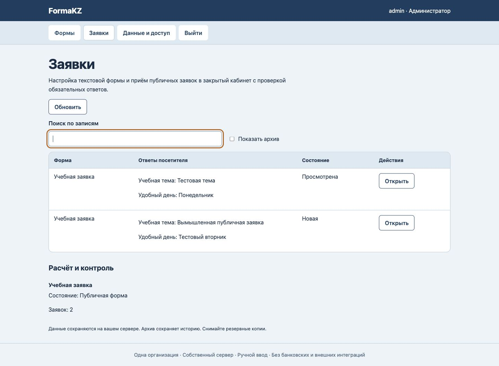

# FormaKZ

Актуальный локальный кандидат: **36/36 тестов**, Node24.19.0. [Свежая проверка](docs/release-hardening/verification.json) · [Состояние предварительного выпуска](PRE_RELEASE.md). PR остаётся черновиком; слияние и публикация не выполнялись.


Настройка текстовой формы и приём публичных заявок в закрытый кабинет с проверкой обязательных ответов.

Самостоятельная оригинальная реализация узкого процесса. Версия 0.1.0 для одной организации на собственном сервере, с ручным вводом и проверкой человеком. Общая инфраструктура разработана для серии продуктов; предметные правила и сценарий этого проекта находятся в module.js. Это не копия исходного кода референса №99 и не его полный аналог.

## Рабочий сценарий

Администратор публикует 1–20 обязательных текстовых вопросов, посетитель отправляет ответы по открытой ссылке; сотрудники читают их в закрытом кабинете и отмечают просмотр.

## Запуск

Нужен Node.js >=24.15 <25 со встроенным node:sqlite. Внешних npm-зависимостей нет.

1. Клонируйте репозиторий и перейдите в папку.
2. Задайте длинный уникальный WORK_ADMIN_PASSWORD (14–200 символов), WORK_ADMIN_USER при необходимости (по умолчанию admin). Не помещайте секрет в git.
3. Выполните npm start. Адрес по умолчанию http://127.0.0.1:8792. PORT меняет порт; PUBLIC_ORIGIN должен точно совпадать с адресом в браузере.
4. Войдите и заведите свои записи. Демонстрационные данные и пароли не включены.

Пример для локального терминала macOS/Linux:

```sh
read -r -s WORK_ADMIN_PASSWORD
export WORK_ADMIN_PASSWORD
npm start
```

Для проверки: npm test. Прогон исходного инкремента: 7 тестов, Node 24.19.0. Вывод — docs/test-output.txt, предметные положительные и отрицательные примеры — tests/scenario.json. Примеры синтетические, не данные клиентов.

## Данные и доступ

SQLite сохраняется в .data/workspace.sqlite (или DATABASE_PATH). Администратор создаёт сотрудников в «Данные и доступ». Роли ограничивают действия, но все сотрудники одной организации видят общую рабочую область: это не изоляция отделов или клиентов. Сеанс — HttpOnly/SameSite cookie, изменения — с CSRF и проверкой Origin; пароли — scrypt. Есть журнал и проверка версии записи от перезаписи устаревшим окном. Это не сертификат безопасности.

JSON-копия из интерфейса содержит рабочие данные и восстанавливается только в пустую базу того же продукта; аккаунты и журнал не переносит. Полная согласованная копия и восстановление в НОВЫЙ файл доступны через CLI: [OPERATIONS.md](OPERATIONS.md).

Публикация сервера требует отдельного HTTPS reverse proxy, собственного hostname, резервного копирования, правил хранения данных и проверки ролей. По умолчанию сервер доступен только на loopback. GitHub размещает исходный код, а не этот сервер. Не размещайте разные недоверенные приложения на одном hostname: порты не изолируют browser cookies. Для первого пилота используйте обезличенные данные. Администратор может завершать сеансы в «Данные и доступ». Сброса пароля и отключения аккаунта в интерфейсе нет.

## Границы

Нет файлов, условных веток, оплаты, встроенного согласия на обработку данных и anti-bot сервиса. Для реального сбора данных оператор добавляет свой текст согласия и меры защиты. Нет multi-tenant SaaS, внешних интеграций, платежей и подтверждённого промышленного SLA. UI на русском. Часовой пояс дат со временем выбирается явно, дневные даты без часового пояса.

Лицензия: все права сохранены; публичное чтение исходников не выдаёт коммерческую лицензию. Условия пилота/адаптации обсуждаются отдельно. Коммерческий сценарий и потенциальные компании — docs/buyers.json и docs/offer.md.

[Справка Node SQLite](https://nodejs.org/docs/latest-v24.x/api/sqlite.html) · [Предметная спецификация](PRODUCT.md) · [Проверки и ограничения](docs/verification.json)

## Вид рабочего сценария



Синтетические данные браузерной проверки, не данные или результаты клиента.

## История заявок

Редактор прежней заявки сохраняет выбранное название архивной формы с пометкой «Архив»; связь остаётся отключённой для изменений. Вопросы/ответы и отметка просмотра сохраняются. Закрытая черновая/архивная публичная форма отвергает новые GET/POST, включая отправку из ранее открытого окна. [Проверка формы и существующих ограничений](docs/history-fix.md).


## Предрелизный интерфейс · 26 октября 2026

Библиотека форм, живой предпросмотр вопросов и отдельная очередь чтения заявок. [Дизайн](DESIGN.md) · [Проверки и оставшиеся условия выпуска](PRE_RELEASE.md). Прежние скриншоты относятся к предыдущему интерфейсу.

## Запуск, сеансы и полные копии · 26 октября 2026

Добавлены read-only preflight, health с ограниченным временем, приватный запуск, список/отзыв сеансов и согласованная SQLite-копия с восстановлением в новый файл. [Команды и границы эксплуатации](OPERATIONS.md) · [Актуальная локальная проверка](docs/release-hardening/verification.json). Шаблоны Caddy/systemd поставлены, на реальном хосте не запускались.
