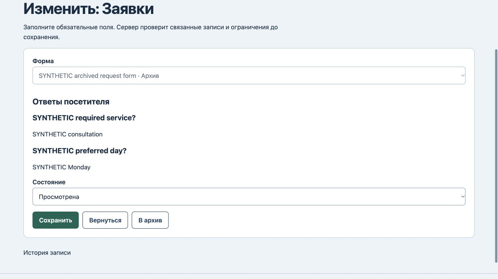
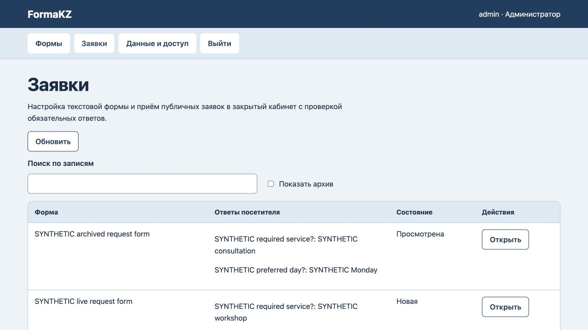

# FormaKZ: источник прежней заявки

25 октября2026. В редакторе заявки после архивирования формы пропадало её название: отключённое поле показывало «Выберите значение». Вопросы, ответы и сохранение отметки «Просмотрена» уже работали — это проверено в браузере на прежнем коде.

Исправлены только варианты поля: прежняя архивная форма остаётся выбранной с пометкой «Архив», ссылка по-прежнему недоступна для изменения. Другие архивные формы не предлагаются. Сервер и схема данных не менялись.

Все7 тестов прошли. Две добавленные проверки сохранённых правил прошли ещё на baseline: файловый перезапуск/восстановление истории и отказ GET/устаревшего POST для черновой/архивной публичной формы. Они не объявляются новыми исправленными серверными дефектами.6 HTTP400 отказов на синтетическом сервере сохранили все данные/версию8/журнал8.

В браузере отметка просмотра сохранилась с прежней формой, вопросами и ответами; действующая публичная форма приняла новую синтетическую заявку, архивная ссылка показала отказ. После перезагрузки —3 заявки, прежние формы и другая заявка не изменены, версия10/журнал10. [Машинная проверка](history-verification.json).

Работающий локальный сервер отдаёт точный новый app.js без перезапуска;18 сохранённых состояний не изменились. «Просмотрена» — ручная отметка сотрудника, не подтверждение исполнения услуги. Нет файлов, оплаты, условных веток, встроенного согласия, промышленного размещения и клиентской приёмки. Полный новый аудит интерфейса или безопасности не проводился.
